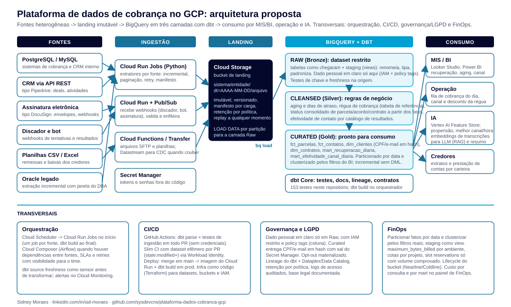
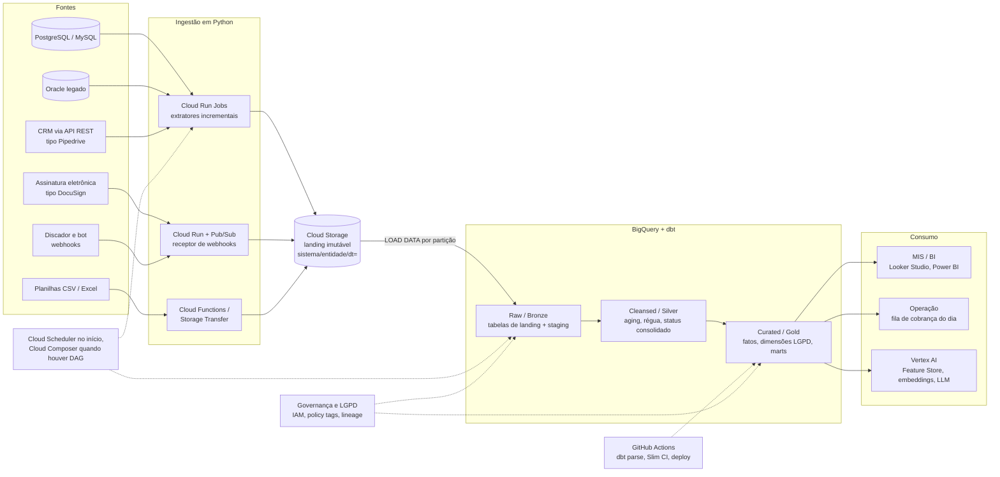

# Plataforma de dados de cobrança no GCP

[](https://github.com/sysdevcns/plataforma-dados-cobranca-gcp/actions/workflows/ci.yml)

**Como eu abordaria a plataforma de dados de uma operação de cobrança e recuperação de crédito no Google Cloud.**

Este repositório tem duas partes que se complementam:

1. **A proposta de arquitetura** (este README e a versão resumida em [docs/proposta-peopleware.pdf](docs/proposta-peopleware.pdf)):
   leitura do desafio, desenho da plataforma, decisões e trade-offs, plano de 90 dias e riscos.
2. **Um projeto dbt funcional sobre o BigQuery**, com um dataset sintético de cobrança (contratos, parcelas,
   acordos, pagamentos e contatos de discador/bot), três camadas de dados, 153 testes, mascaramento LGPD,
   scripts de ingestão e CI. Tudo roda no sandbox gratuito do BigQuery e foi executado de verdade
   (resultado do `dbt build` na [seção 4.5](#45-resultado-do-dbt-build-no-bigquery)).

É a continuação de um projeto anterior, [dbt-bigquery-demo](https://github.com/sysdevcns/dbt-bigquery-demo),
que serviu de prova de dbt + BigQuery + Git sobre um dataset público de e-commerce. Aqui o mesmo padrão é
aplicado ao domínio de cobrança, com as perguntas que uma consultoria de recuperação de crédito faz todo dia:
quanto da carteira vencida virou dinheiro, em que faixa de atraso o dinheiro está parado, qual canal e
fornecedor traz contato efetivo pelo menor custo, e como entregar isso para o MIS, para a operação e para
modelos de IA sem expor dado pessoal.

> Sobre o tom deste documento: o que está marcado como **proposta** é como eu desenharia e defenderia a
> solução; não é relato de projeto entregue. Minha experiência prática em cobrança vem de atuar como a pessoa
> de dados do canal digital de cobrança (discador, bot, indicadores e fontes), e de 15+ anos em MIS/BI,
> SQL Server/PostgreSQL, Python e arquitetura Medallion na área financeira. Cloud Composer, Vertex AI e
> Oracle aparecem aqui como escolhas de arquitetura que eu sei justificar, estudadas para este desenho.

---

## Sumário

1. [Leitura do desafio](#1-leitura-do-desafio)
2. [Arquitetura proposta](#2-arquitetura-proposta)
3. [Decisões e trade-offs](#3-decisões-e-trade-offs)
4. [O que está implementado neste repositório](#4-o-que-está-implementado-neste-repositório)
5. [Ingestão: planilhas, APIs, webhooks e Oracle](#5-ingestão-planilhas-apis-webhooks-e-oracle)
6. [Dados para IA](#6-dados-para-ia)
7. [Governança e LGPD](#7-governança-e-lgpd)
8. [FinOps](#8-finops)
9. [Plano de 90 dias](#9-plano-de-90-dias)
10. [Riscos e mitigações](#10-riscos-e-mitigações)
11. [Como rodar](#11-como-rodar)
12. [Estrutura do repositório](#12-estrutura-do-repositório)

---

## 1. Leitura do desafio

Uma operação de cobrança terceirizada trabalha com **carteiras de vários credores** e com **fornecedores
que mudam**: discador, bot de WhatsApp, SMS, e-mail, plataforma de acordos, assinatura eletrônica. Cada um
tem seu formato e seu ritmo. O que a plataforma de dados precisa resolver, na ordem em que dói:

| Dor | O que ela custa | O que a plataforma precisa garantir |
|---|---|---|
| **Fontes heterogêneas**: PostgreSQL/MySQL dos sistemas internos, CRM via API REST (tipo Pipedrive), assinatura eletrônica (tipo DocuSign), webhooks de discador e bot, planilhas CSV/Excel dos credores, Oracle legado | Cada integração vira um script solto; quando o fornecedor muda o layout, o MIS para | Um padrão único de ingestão (extrair -> depositar imutável -> carregar -> transformar), com manifesto e linhagem por carga, para que trocar de fornecedor seja trocar um extrator e não refazer o MIS |
| **Indicadores que não batem** entre MIS, operação e credor (taxa de recuperação, aging, efetividade) | Reuniões para conciliar número em vez de decidir | Regras de negócio em um só lugar (camada Cleansed), testadas, com reconciliação automática entre camadas |
| **Status desatualizado no CRM** (acordo "ativo" que já quebrou, parcela "aberta" já paga) | Operação cobra quem já pagou, deixa de cobrar quem quebrou acordo | Status consolidado derivado do fato (pagamentos recebidos), não do campo preenchido na tela |
| **Dado pessoal espalhado** (CPF, telefone, e-mail em planilha e dashboard) | Risco LGPD e de reputação com os credores | Dado em claro só na camada Raw com acesso restrito; Curated entrega hash, faixas e flags (opt-out) |
| **Custo de nuvem imprevisível** quando o BI começa a consultar tabelas grandes | Fatura cresce sem ninguém saber de onde | Particionamento, clustering, cotas por projeto e custo por mart visível desde o primeiro dia |
| **Preparar dados para IA** (propensão a pagar, melhor canal e horário, resumo de ligações) | Cientista de dados monta base na mão, cada vez diferente | Features versionadas a partir da camada Curated e texto (transcrições) pronto para embeddings |

## 2. Arquitetura proposta





### Componentes e papel de cada um

| Bloco | Serviço GCP | Papel na proposta |
|---|---|---|
| Landing | **Cloud Storage** | Todo dado entra como arquivo imutável em `sistema/entidade/dt=AAAA-MM-DD/`, com manifesto (origem, janela, contagem, hash). Reprocessar é reler o arquivo, não refazer a extração. Versionamento e lifecycle (Nearline/Coldline) por política. |
| Ingestão batch | **Cloud Run Jobs** (Python) | Um job por fonte: extração incremental por marca d'água, paginação, retry com backoff, segredo via Secret Manager. Mesmo código roda local, no CI e em produção ([ingest/](ingest/)). |
| Ingestão por evento | **Cloud Run + Pub/Sub** | Receptor de webhooks de discador, bot e assinatura eletrônica: valida assinatura do fornecedor, publica no tópico, subscriber grava em micro-lotes no landing. Desacopla o pico do fornecedor do ritmo de carga. |
| Arquivos | **Cloud Functions / Storage Transfer** | Planilhas por SFTP ou e-mail caem no bucket; função normaliza nome e move para o caminho padrão. |
| CDC | **Datastream** (quando couber) | Para PostgreSQL/MySQL com volume e necessidade de latência baixa; caso contrário, extração incremental por coluna de auditoria basta e custa menos. |
| Armazém | **BigQuery** | Três camadas em datasets separados (`_raw`, `_staging`, `_intermediate`, `_marts`), IAM por dataset, policy tags por coluna. |
| Transformação | **dbt Core** | Modelos SQL versionados, testes, documentação e lineage. Staging e intermediate como view, marts como tabela particionada/clusterizada ou incremental. |
| Orquestração | **Cloud Scheduler -> Cloud Run Jobs** no início; **Cloud Composer (Airflow)** quando houver dependências entre fontes, SLAs e retries com visibilidade para o time | Começar simples e barato; migrar para Composer quando o DAG justificar o custo fixo do ambiente. `dbt source freshness` como sensor antes de transformar. |
| CI/CD | **GitHub Actions** | `dbt parse` e testes de ingestão em todo PR sem credenciais; Slim CI (`state:modified+`) em dataset efêmero via Workload Identity Federation; merge em `main` publica imagem do Cloud Run e roda `dbt build` em produção. Terraform para datasets, buckets e IAM. |
| IA | **Vertex AI Feature Store, Embeddings, Gemini** | Features de propensão e de melhor canal/horário a partir da camada Curated; transcrições de ligação e conversas de bot viram embeddings para busca e resumo por LLM (seção 6). |
| Governança | **IAM, policy tags, Dataplex/Data Catalog, Cloud Audit Logs** | Quem vê o quê, por coluna; lineage do dbt publicado no catálogo; acesso a dado pessoal auditado (seção 7). |
| FinOps | **Particionamento, clustering, cotas, `maximum_bytes_billed`, painel de billing export** | Custo previsível por ambiente e por mart (seção 8). |

## 3. Decisões e trade-offs

| Decisão | Por quê | O que eu abro mão / quando reveria |
|---|---|---|
| **dbt Core em vez de SQL agendado, Dataform ou procedures** | Versionamento, testes como código, documentação e lineage gerados, ambientes dev/prod isolados, ecossistema (`dbt_utils`, elementary). Qualquer pessoa de SQL aprende em dias. É o que permite dizer "o número do MIS tem teste". | Dataform é nativo do GCP e gratuito; escolheria Dataform se o time fosse 100% BigQuery sem pretensão de portabilidade e sem necessidade dos pacotes do dbt. Procedures só para rotinas pontuais. |
| **Não "copiar o Bronze" dentro do BigQuery** | O landing físico é o Cloud Storage (barato, imutável, replay). No BigQuery a camada Raw é a tabela carregada do landing + views de staging que renomeiam e tipam. Duplicar a tabela crua em outro dataset só dobra armazenamento e cria uma cópia que ninguém testa. | Em um lake Parquet (Databricks/Spark) o Bronze seria a ingestão física; aqui esse papel é do bucket. Neste repositório, por rodar no sandbox, as tabelas Raw são **seeds** do dbt carregadas dos mesmos CSVs. |
| **Staging e intermediate como view; marts como tabela** | View não custa armazenamento e nunca fica defasada; regra de negócio em view é reutilizada por vários marts. Marts são lidos muitas vezes por dia pelo BI: materializar uma vez e servir barato. | Intermediate pesado (ex.: aging diário de milhões de parcelas) vira `table` particionada ou `ephemeral`. |
| **Quando particionar** | Fatos e marts diários: particionar por data (dia) quando a tabela passa de ~1 GB **ou** quando há filtro de data dominante nas consultas; abaixo disso clustering costuma bastar. Dimensões: só clustering. Granularidade mensal em `fct_parcelas` (safra de vencimento) evita partições minúsculas e o limite de 4.000 partições. | Particionar tabela pequena é anti-padrão: mais metadados que dado. A decisão está escrita no `config()` de cada mart. |
| **Clustering pelas colunas filtradas no BI** | Carteira, status, canal e fornecedor são os filtros reais dos dashboards; o BigQuery lê só os blocos relevantes. A primeira coluna de cluster é a mais filtrada. | Clustering não ajuda em `SELECT *` sem filtro; reavaliar com o `INFORMATION_SCHEMA.JOBS` (bytes lidos por consulta). |
| **Incremental `insert_overwrite` por partição, sem `MERGE`** | Webhooks de discador e bot chegam atrasados e com correção: reescrever as últimas N partições inteiras é idempotente, barato e não exige chave de merge. `copy_partitions` usa a API de cópia (sem DML, roda até no sandbox). | `MERGE` quando a fonte envia só deltas por chave e a tabela é grande demais para reescrever partições. |
| **Status consolidado derivado do fato, não do CRM** | O CRM informa o que alguém digitou; os pagamentos mostram o que aconteceu. Acordo quebrado, parcela paga e contrato quitado são recalculados dos pagamentos, e a divergência com o CRM vira indicador de qualidade da origem. | Exige acordo com a operação sobre a regra (tolerância de 30 dias para quebra, 10 para cancelamento). A regra fica em um único modelo (`int_acordos__status`) e muda por PR. |
| **Régua e catálogo de resultados como tabelas de referência (seeds)** | A régua (faixa de atraso -> fase, canal, desconto) e o que conta como "contato efetivo" em cada canal são decisões da operação, não do código. Em seed, mudam por PR com revisão, e todos os marts enxergam a mesma versão. | Quando a régua passar a variar por carteira e por período, vira tabela com vigência (SCD2) mantida por tela, não por seed. |
| **Extração incremental de Oracle legado com janela negociada com o DBA** | Oracle legado costuma ser crítico e sem réplica. Proposta: extrator Python (`python-oracledb`) lendo por coluna de auditoria (`DT_ALTERACAO`) em janela acordada com o DBA (ex.: 01h às 05h), lotes de tamanho fixo, `ROWID`/chave para retomada, limite de sessões e sem `SELECT *` em tabela sem índice na coluna de corte. Carga inicial em fatias por período, fora do horário. | GoldenGate/Datastream para Oracle resolve CDC de verdade, mas custa licença e exige mudança no banco; só proporia depois de medir o volume e a latência que a operação realmente precisa. Tabela sem coluna de auditoria confiável vira extração completa com hash por linha para detectar mudança. |
| **Cloud Scheduler primeiro, Composer depois** | Composer tem custo fixo relevante (ambiente ligado 24x7) e curva de operação. Com meia dúzia de fontes independentes, Scheduler + Cloud Run Jobs + alertas resolve. | Composer quando houver dependências reais entre fontes, SLA de entrega por carteira, backfills frequentes e um time que precise ver o DAG. A migração é só trocar o disparador: os jobs já são contêineres. |
| **Hash com sal para CPF e e-mail na Curated** | Mantém join e deduplicação entre sistemas sem expor a pessoa; sal no Secret Manager impede reversão por força bruta (CPF tem só 11 dígitos). | Hash não é anonimização definitiva (é pseudonimização); quem precisa do dado em claro consulta a Raw com acesso auditado. Tokenização via Cloud DLP se o requisito for reversibilidade controlada. |

## 4. O que está implementado neste repositório

### 4.1 Dataset sintético de cobrança

Gerado por [scripts/gerar_dados_sinteticos.py](scripts/gerar_dados_sinteticos.py) (só biblioteca padrão,
determinístico, semente fixa) e versionado em `seeds/`. Nenhum dado real: CPFs, nomes, e-mails e telefones
são aleatórios. Os credores e fornecedores são fictícios.

| Tabela (seed) | Linhas | O que representa |
|---|---:|---|
| `raw_clientes` | 600 | Devedores PF com dados cadastrais. Sujeira proposital: CPF com e sem máscara, e-mail em maiúsculas, UF em minúsculas. |
| `raw_contratos` | 900 | Contratos cedidos por 4 carteiras (banco, financeira, varejo, telecom), com `status_crm` nem sempre atualizado. |
| `raw_parcelas` | 11.195 | Parcelas originais com vencimento, valor e status informado pelo credor. |
| `raw_acordos` | 149 | Renegociações fechadas por discador ou bot: dívida, desconto, entrada, plano. |
| `raw_pagamentos` | 8.200 | Pagamentos de parcelas originais e de parcelas de acordo (boleto, Pix, débito, cartão). |
| `raw_contatos` | 17.260 | Tentativas por discador, URA, bot de WhatsApp, SMS e e-mail, com fornecedor, resultado, duração e custo unitário. |
| `regua_cobranca` | 5 | Referência: faixa de atraso -> fase, canal prioritário, ação, desconto máximo. |
| `resultado_contato` | 27 | Referência: catálogo (canal, resultado) -> contato efetivo, promessa, acordo, opt-out. |

Cada contrato segue um perfil de pagamento (adimplente, atrasa e paga, inadimplente a partir de uma parcela,
errático), os contatos seguem a régua (SMS/bot nos primeiros dias, discador depois, e-mail e jurídico no fim)
e os acordos podem ser cumpridos, quebrados ou cancelados. É o suficiente para aging, régua, recuperação e
efetividade terem distribuições que fazem sentido.

### 4.2 Camadas

| Medallion | Nome aqui | Camada dbt | Materialização | O que acontece |
|---|---|---|---|---|
| Bronze | **Raw** | `seeds raw_*` + `models/staging/` | table (seed) + view | Dado como chegou. Staging só renomeia, tipa e padroniza (CPF só dígitos, e-mail minúsculo, `credor` vira `carteira`). Dado pessoal em claro fica só aqui. |
| Silver | **Cleansed** | `models/intermediate/` | view | Regras de negócio: status consolidado de acordo, parcela e contrato; dias de atraso e faixa de aging; posição na régua; efetividade de contato pelo catálogo; conversão em acordo em 7 dias. |
| Gold | **Curated** | `models/marts/` | table / incremental | Fatos, dimensões com LGPD e marts prontos para MIS, operação e IA. Particionamento e clustering declarados por modelo. |

### 4.3 Modelos

**Cleansed / Silver** (`models/intermediate/`)

| Modelo | Grão | Regras que vivem aqui |
|---|---|---|
| `int_acordos__status` | acordo | Status consolidado a partir dos pagamentos (`quitado`, `ativo`, `quebrado`, `cancelado`) e flag de divergência com o CRM. |
| `int_parcelas__aging` | parcela | Pagamento, `dias_atraso` (na data de referência ou na data do pagamento), `aging_bucket`, `status_consolidado` (`paga`, `paga_parcial`, `renegociada`, `vencida`, `a_vencer`), `saldo_aberto`, fase e canal da régua. Parcela coberta por acordo vigente sai do aging; se o acordo quebrou, volta. |
| `int_contratos__regua` | contrato | Saldo vencido, atraso máximo, parcelas por status, acordo vigente, contatos, posição na régua e `status_consolidado` (`quitado`, `em_acordo`, `inadimplente`, `em_dia`). |
| `int_contatos__classificados` | tentativa de contato | Flags do catálogo (efetivo, promessa, acordo, opt-out), atraso e fase da régua no dia do contato, se o canal era o prioritário, conversão em acordo em até 7 dias. |

**Curated / Gold** (`models/marts/`)

| Modelo | Grão | Partição (fora do sandbox) | Cluster | Para quem |
|---|---|---|---|---|
| `core/fct_parcelas` | parcela | `data_vencimento` (mês) | `carteira`, `status_consolidado` | Fonte única de saldo e recuperação |
| `core/fct_contatos` | tentativa de contato | `data_contato` (dia), incremental `insert_overwrite` | `canal`, `fornecedor` | Efetividade e features de melhor canal/hora |
| `core/dim_clientes` | cliente | - | `uf`, `fase_regua_pior` | BI e ciência de dados, **sem dado pessoal em claro** |
| `core/dim_contratos` | contrato | - | `carteira`, `fase_regua`, `status_consolidado` | Fila de trabalho da operação (`analyses/fila_de_cobranca_hoje.sql`) |
| `cobranca/mart_recuperacao_diaria` | dia x carteira | `data_referencia` (dia) | `carteira` | MIS: saldo vencido no início do dia por faixa de aging, valor recuperado (parcelas em atraso + acordos), acordos fechados, taxa de recuperação do dia, índice de desconto |
| `cobranca/mart_efetividade_canal_diaria` | dia x carteira x canal x fornecedor | `data_contato` (dia) | `canal`, `fornecedor`, `carteira` | Comparar discador, bot e mensageria: taxa de contato efetivo, promessas, conversão em 7 dias, opt-out, custo por contato efetivo e por acordo |

Macros: `is_sandbox` (desliga partição no sandbox), `data_referencia` (data de corte parametrizável),
`hash_pii` (SHA-256 com sal), `aging_bucket` (faixas únicas para toda a plataforma).

### 4.4 Testes

153 testes declarados em YAML mais 3 testes singulares, todos executados em todo `dbt build`:

| Tipo | Exemplos |
|---|---|
| `unique` / `not_null` | Chaves de todas as camadas, inclusive dos seeds de referência. |
| `relationships` | Parcela -> contrato, pagamento -> parcela/acordo, contato -> contrato, fato -> dimensões. |
| `accepted_values` | Canais, status consolidados, fases da régua, faixas de aging, segmentos, meios de pagamento. |
| `dbt_utils` | `accepted_range` (valores e taxas), `expression_is_true` (pagamento aponta para parcela **ou** acordo, acordo <= dívida, parcelas pagas <= plano, soma das faixas de aging = saldo do dia, hash com 64 caracteres e sem formato de CPF), `unique_combination_of_columns` nos grãos dos marts, `not_null_proportion`, `not_empty_string`. |
| Genérico customizado | `date_not_before`: vencimento e pagamento nunca antes da contratação. |
| Singulares | `assert_recuperacao_reconcilia_com_pagamentos` (total recuperado no mart = pagamentos na Raw, tolerância R$ 0,01); `assert_dim_clientes_sem_dado_pessoal_em_claro` (consulta o `INFORMATION_SCHEMA` para garantir que não existe coluna `cpf`, `email`, `nome`, `telefone` e que nenhum hash parece CPF ou e-mail); `assert_acordo_quitado_tem_pagamento_integral`. |
| Severidade `warn` | Contato fora da janela 8h-20h; contato sem parcela em atraso (preventivo). Avisa sem parar o pipeline. |

O teste de reconciliação já pagou o esforço durante a construção: ele apontou pagamentos com data futura no
gerador e um saldo diário calculado com o valor pago de hoje em vez do valor em aberto naquele dia. Nos dois
casos o número do mart estava "bonito" e errado.

### 4.5 Resultado do `dbt build` no BigQuery

Executado no sandbox gratuito do BigQuery (projeto pessoal, `location: US`, dataset `dbt_cobranca`):

```
$ dbt build --profiles-dir .
Running with dbt=1.12.6
Registered adapter: bigquery=1.12.1
Found 16 models, 1 analysis, 153 data tests, 8 seeds, 682 macros
Concurrency: 4 threads (target='dev')
Finished running 8 seeds, 6 table models, 153 data tests, 10 view models in 0 hours 2 minutes and 57.78 seconds (177.78s).
Completed successfully
Done. PASS=177 WARN=0 ERROR=0 SKIP=0 NO-OP=0 REUSED=0 TOTAL=177
```

Lição do sandbox herdada do projeto anterior: todo dataset do sandbox nasce com **expiração de partição de
60 dias**, não alterável sem faturamento. Em tabela particionada por data, as partições antigas são
descartadas na própria gravação e o histórico some. O macro `is_sandbox()` desliga o `partition_by` (e o
incremental) quando o alvo é o sandbox; fora dele (`--vars '{bigquery_sandbox: false}'` ou target `prod`)
valem as decisões documentadas em cada mart.

## 5. Ingestão: planilhas, APIs, webhooks e Oracle

A pasta [ingest/](ingest/) tem o padrão de borda que eu usaria para todas as fontes, exercitado de ponta a
ponta no CI com landing local e uma API REST simulada:

- `ingest_planilha.py`: CSV (detecta `;`, `,`, tab) ou Excel por aba -> CSV no landing com colunas de
  linhagem por linha e manifesto com hash do arquivo original. Nenhuma regra de negócio: se chegou, é
  preservado como chegou; validar é papel dos testes de staging.
- `ingest_api_rest.py`: extração incremental por marca d'água (`updated_since`) com sobreposição, paginação,
  retry com backoff em 429/5xx, token só por variável de ambiente, JSON Lines no landing e estado persistido.
- `mock_api.py`: simula CRM/plataforma de acordos com paginação, filtro incremental, Bearer token e 429 periódico.
- `landing.py`: mesma convenção de caminho local e em `gs://`, com escrita imutável (`if_generation_match=0`).

Em produção: webhooks de discador, bot e assinatura eletrônica entram por Cloud Run + Pub/Sub; Oracle legado
segue o mesmo extrator com `python-oracledb` e janela negociada com o DBA (seção 3); do landing para a Raw é
`LOAD DATA` por partição `dt=`, disparado pelo mesmo orquestrador que depois roda `dbt build`.

## 6. Dados para IA

A camada Curated já é a base de features. O que eu proporia, nesta ordem:

1. **Features tabulares para propensão a pagar e a fechar acordo**, por contrato e por cliente, lidas de
   `dim_contratos`, `dim_clientes` e `fct_contatos`: atraso máximo, faixa de aging, histórico de atraso nas
   parcelas pagas, acordos quebrados, contatos efetivos nos últimos 30/90 dias, canal e hora dos contatos
   efetivos, opt-out. Publicadas no **Vertex AI Feature Store** (BigQuery como fonte offline, serving online
   para o discador decidir em tempo real). Versionadas pelo dbt, com `data_referencia` como ponto no tempo
   para evitar vazamento de futuro no treino.
2. **Melhor canal e melhor horário** como modelo de recomendação simples sobre `mart_efetividade_canal_diaria`
   e `fct_contatos` (uplift por faixa de atraso, carteira, hora e canal), alimentando a régua dinamicamente.
3. **Texto para LLM**: transcrições do discador e conversas do bot (quando o fornecedor entregar) vão para
   o landing, passam por **Cloud DLP** para remover dado pessoal e viram **embeddings** (Vertex AI Embeddings,
   armazenados no próprio BigQuery com `VECTOR_SEARCH` ou no Vertex Vector Search). Casos de uso: resumo
   automático da negociação para o operador, classificação de motivo de não pagamento, busca de conversas
   semelhantes para treinar o bot e auditoria de conduta (RAG com Gemini sobre a política de cobrança).
4. **Governança de modelo**: dataset de treino materializado e versionado, métricas de desempenho por carteira,
   monitoramento de drift. Decisão automatizada sobre pessoa (LGPD art. 20) exige explicabilidade e revisão
   humana: o modelo prioriza fila, não decide sozinho.

## 7. Governança e LGPD

| Camada | Dado pessoal | Quem acessa | Controle |
|---|---|---|---|
| Landing (GCS) | Em claro, como chegou | Service accounts de ingestão e carga | Bucket privado, CMEK se o credor exigir, retenção por política, versionamento, logs de acesso |
| Raw / Staging | Em claro, padronizado | Time de dados; operação e jurídico por exceção | Dataset separado, IAM mínimo, **policy tags** nas colunas `cpf`, `email`, `telefone`, `nome`; Cloud Audit Logs de leitura ativados |
| Cleansed | Chaves técnicas | Time de dados | Views sem colunas de contato |
| Curated | **Nenhum dado pessoal direto**: CPF e e-mail em hash com sal, nome em iniciais, telefone só DDD, idade em faixa, CEP com 5 dígitos | BI, MIS, ciência de dados, credores (por carteira) | Teste automático (`assert_dim_clientes_sem_dado_pessoal_em_claro`) falha o build se alguém expuser coluna proibida; linha de acesso por carteira via authorized views ou RLS |

Mais: **opt-out** materializado em `dim_clientes` e `dim_contratos` para a régua e o discador respeitarem;
**lineage** gerado pelo dbt (`dbt docs`) e publicado no Dataplex/Data Catalog; base legal e finalidade
documentadas por fonte no YAML (`description`); descarte: tabelas de landing e Raw com expiração alinhada ao
contrato com o credor; sal do hash no Secret Manager com rotação planejada (rotação exige reprocessar a
Curated, por isso é evento controlado).

## 8. FinOps

- **Ler menos**: fatos particionados por data e clusterizados pelos filtros reais; staging e intermediate como
  view (zero armazenamento); `maximum_bytes_billed` no profile por ambiente (2 GB em dev, 50 GB em prod) como
  trava; `dev` lê janela reduzida.
- **Guardar menos**: landing com lifecycle (Nearline após 30 dias, Coldline após 180); Raw com expiração
  alinhada à retenção acordada; marts recriáveis a partir da Raw, sem cópias "de segurança".
- **Saber quanto custa**: billing export para o BigQuery + `INFORMATION_SCHEMA.JOBS` dão custo por consulta,
  por usuário e por mart; painel de FinOps é o primeiro dashboard da plataforma sobre ela mesma.
- **Cotas**: cota diária de bytes por projeto e por usuário, projetos separados para dev/prod, alerta de
  orçamento no Cloud Billing.
- **Quando mudar de modelo de preço**: on-demand até o consumo ficar previsível; slot reservations (editions)
  só com histórico de uso que prove economia.

## 9. Plano de 90 dias

| Bloco | Semanas | Entregas | Como se mede |
|---|---|---|---|
| **1. Fundação e primeira carteira** | 1 a 4 | Projetos GCP dev/prod, buckets, datasets, IAM e Terraform; padrão de ingestão (landing + manifesto) com as duas fontes mais críticas (sistema de cobrança e discador); projeto dbt com Raw/Cleansed/Curated para **uma carteira**; `fct_parcelas`, `dim_contratos` e `mart_recuperacao_diaria`; testes e CI com `dbt parse`; `dbt build` diário por Cloud Scheduler | Taxa de recuperação e aging da carteira piloto batendo com o MIS atual (ou divergência explicada); build diário sem intervenção por 2 semanas |
| **2. Todas as fontes e governança** | 5 a 8 | CRM via API, planilhas dos credores, bot e assinatura eletrônica no padrão; Oracle legado com janela do DBA; `fct_contatos`, `dim_clientes` com LGPD, `mart_efetividade_canal_diaria`; policy tags e authorized views por credor; Slim CI em dataset efêmero; alertas de freshness e falha de teste | Todas as carteiras na plataforma; nenhum dashboard lendo CPF em claro; tempo de onboarding de uma fonte nova <= 1 semana |
| **3. Operação e IA** | 9 a 13 | Fila de cobrança do dia servida da Curated para a operação; features de propensão e melhor canal/horário no Feature Store; piloto de embeddings sobre transcrições (se disponíveis) com Cloud DLP; painel de FinOps; decisão sobre Composer com base no DAG real; documentação e passagem de bastão | Operação usando a fila; modelo de propensão em teste A/B em uma carteira; custo mensal da plataforma conhecido e dentro do orçamento |

## 10. Riscos e mitigações

| Risco | Probabilidade / impacto | Mitigação |
|---|---|---|
| Fornecedor muda layout do webhook ou da planilha sem aviso | Alta / médio | Landing imutável guarda o que chegou; testes de staging falham antes de contaminar o mart; catálogo de resultados em seed isola o MIS da mudança; contrato de dados por fornecedor documentado |
| Oracle legado sem janela ou sem coluna de auditoria confiável | Média / alto | Negociar janela e limite de sessões com o DBA na semana 1; extração em fatias com retomada; hash por linha para detectar mudança quando não há auditoria; medir volume antes de prometer latência |
| Indicadores não batem com o MIS atual na virada | Alta / alto | Período de operação paralela com reconciliação automatizada (teste singular por indicador) e divergências explicadas por escrito antes de desligar o antigo |
| Exposição de dado pessoal em dashboard ou extração | Baixa / muito alto | Curated sem dado em claro por construção e por teste; policy tags; auditoria de leitura; revisão de LGPD em todo PR que toque `dim_clientes` |
| Custo de BigQuery cresce com consultas mal escritas do BI | Média / médio | Partição e cluster nos marts; `maximum_bytes_billed`; cota por usuário; painel de custo por consulta na primeira semana |
| Composer adotado cedo demais (custo fixo e operação) | Média / baixo | Começar com Scheduler + Cloud Run Jobs; critério objetivo para migrar (dependências, SLA, backfill) |
| Dependência de uma pessoa | Média / alto | Tudo em Git com README, YAML descritivo e `dbt docs`; CI que impede regressão; passagem de bastão no bloco 3 |
| Modelo de IA decidindo sem revisão | Baixa / alto | Modelo prioriza fila, humano decide; explicabilidade por feature; monitoramento de viés por carteira e faixa |

## 11. Como rodar

Pré-requisitos: Python 3.10 a 3.13, Git, [gcloud](https://cloud.google.com/sdk/docs/install) e um projeto no
[sandbox do BigQuery](https://console.cloud.google.com/bigquery) (gratuito, sem cartão).

```bash
git clone https://github.com/sysdevcns/plataforma-dados-cobranca-gcp.git
```

```bash
cd plataforma-dados-cobranca-gcp && python -m venv .venv
```

Windows: `.\.venv\Scripts\Activate.ps1`; Linux/macOS: `source .venv/bin/activate`.

```bash
pip install -r requirements.txt
```

```bash
gcloud auth application-default login
```

```bash
cp profiles.yml.example profiles.yml
```

Edite `profiles.yml` e troque `seu-projeto-gcp` pelo ID do seu projeto (`profiles.yml` está no `.gitignore`).

```bash
dbt deps --profiles-dir .
```

```bash
dbt debug --profiles-dir .
```

```bash
dbt build --profiles-dir .
```

Outros comandos úteis:

```bash
dbt build --profiles-dir . --vars "{data_referencia: '2026-09-30'}"
```

```bash
dbt run --profiles-dir . --select tag:gold
```

```bash
dbt test --profiles-dir . --select fct_parcelas+
```

```bash
dbt docs generate --profiles-dir . && dbt docs serve --profiles-dir .
```

Regenerar o dataset sintético (determinístico; mude `--seed` para outra amostra):

```bash
python scripts/gerar_dados_sinteticos.py --data-corte 2026-10-14
```

Scripts de ingestão: ver [ingest/README.md](ingest/README.md).

## 12. Estrutura do repositório

```
plataforma-dados-cobranca-gcp/
├── README.md                          # esta proposta
├── docs/
│   ├── proposta-peopleware.pdf        # versão resumida da proposta (2 páginas)
│   ├── proposta-peopleware.html       # fonte do PDF
│   └── arquitetura.svg                # diagrama da arquitetura
├── dbt_project.yml                    # camadas, schemas, vars (data_referencia, pii_salt)
├── packages.yml                       # dbt_utils
├── profiles.yml.example               # conexão (copiar para profiles.yml, ignorado pelo git)
├── requirements.txt
├── .github/workflows/ci.yml           # dbt deps + parse; ingestão de ponta a ponta
├── scripts/gerar_dados_sinteticos.py  # gerador do dataset
├── seeds/                             # RAW (raw_*) e referência (regua_cobranca, resultado_contato)
├── models/
│   ├── staging/cobranca/              # RAW / BRONZE: 6 views + YAML com testes
│   ├── intermediate/                  # CLEANSED / SILVER: 4 views com as regras de negócio
│   └── marts/
│       ├── core/                      # fct_parcelas, fct_contatos, dim_clientes, dim_contratos
│       └── cobranca/                  # mart_recuperacao_diaria, mart_efetividade_canal_diaria
├── macros/                            # is_sandbox, data_referencia, hash_pii, aging_bucket
├── tests/                             # generic/date_not_before + 3 testes singulares
├── analyses/fila_de_cobranca_hoje.sql # consulta de exemplo para a operação
└── ingest/                            # landing.py, ingest_planilha.py, ingest_api_rest.py, mock_api.py
```

Convenções: prefixos `stg_`, `int_`, `fct_`, `dim_`, `mart_`; YAML começa com `_` ao lado dos modelos;
nomes em português no domínio (carteira, parcela, acordo, régua) e em inglês nas convenções do dbt.

---

Sidney Moraes · [linkedin.com/in/sid-moraes](https://www.linkedin.com/in/sid-moraes) ·
[github.com/sysdevcns](https://github.com/sysdevcns)

Proposta e projeto preparados como material de apoio ao processo seletivo de arquiteto/engenheiro de dados
(GCP) da PeopleWare Tecnologia. Dados, credores e fornecedores citados no projeto são fictícios.
